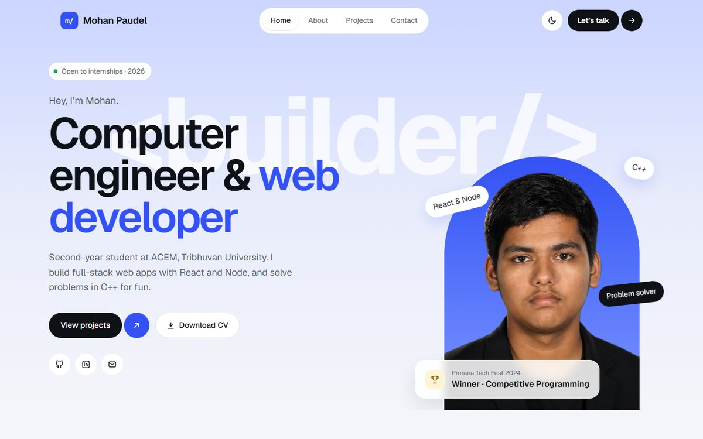

<div align="center">

# Mohan Paudel — Portfolio

Personal website of a second-year Computer Engineering student at ACEM, Tribhuvan University.
<br />
Full-stack web apps with React and Node, problem solving in C++.

**[paudelmohan.com.np](https://paudelmohan.com.np)** · [Download CV](public/resume.pdf) · [GitHub](https://github.com/paudelmohan27) · [LinkedIn](https://linkedin.com/in/paudelmohan27)


<br />

<picture>
  <source media="(prefers-color-scheme: dark)" srcset="docs/preview-dark.jpg" />
  
</picture>

</div>

---

## Features

- **Light and dark mode** — follows the system setting, remembers the visitor's choice, and avoids a flash of the wrong theme on load.
- **Responsive** — designed for phones up to wide desktops, with a mobile menu.
- **Content in one file** — every piece of text, link and project lives in [`src/data/content.js`](src/data/content.js).
- **Subtle motion** — scroll fade-ins and floating tags, all switched off for visitors who prefer reduced motion.
- **Accessible** — semantic HTML, labelled controls, keyboard skip link and visible focus states.
- **No backend needed** — the contact form opens the visitor's mail app with the message filled in.
- **Fast** — about 77 KB of gzipped JavaScript, compressed images, lazy-loaded screenshots.

## Sections

| Section | What it shows |
|---|---|
| Hero | Intro, availability status, CV download and social links |
| About | Short statement and quick facts |
| Toolbox | Languages, web stack and tools |
| Projects | StudyTracker (featured), Boolean Algebra Solver, Digital Diary, CricVerse |
| Journey | Timeline of milestones |
| Contact | Email and a contact form |

## Tech stack

| | |
|---|---|
| Framework | [React 19](https://react.dev) |
| Build tool | [Vite 7](https://vite.dev) |
| Styling | [Tailwind CSS 4](https://tailwindcss.com) with CSS-variable theme tokens |
| Fonts | [Geist and Geist Mono](https://fonts.google.com/specimen/Geist) |
| Hosting | [Vercel](https://vercel.com) |

No UI library and no animation library: icons are inline SVG and the animations are plain CSS with `IntersectionObserver`.

## Getting started

Requires [Node.js](https://nodejs.org) 20.19 or newer.

```bash
git clone https://github.com/paudelmohan27/portfolio.git
cd portfolio
npm install
npm run dev
```

Then open http://localhost:5173.

| Command | What it does |
|---|---|
| `npm run dev` | Start the dev server with hot reload |
| `npm run build` | Build the production site into `dist/` |
| `npm run preview` | Serve the production build locally |

## Project structure

```
├── cv/
│   └── cv.html              CV source (exported to public/resume.pdf)
├── docs/                    README screenshots
├── public/
│   ├── mohan.webp           Portrait (transparent background)
│   ├── resume.pdf           CV linked from the site
│   └── projects/            Project screenshots
└── src/
    ├── data/content.js      All site content
    ├── components/          Navbar, Hero, About, Skills, Projects, Journey, Contact, Footer
    ├── hooks/useTheme.js    Light/dark toggle
    ├── index.css            Theme tokens and animations
    ├── App.jsx
    └── main.jsx
```

## Editing content

Open [`src/data/content.js`](src/data/content.js) and change the text, links or projects. The site updates as soon as you save.

- **Add a project** — add an entry to `projects` with a title, description, stack and links.
- **Project screenshots** — put images in `public/projects/` and set the project's `image`, for example `'/projects/studytracker.jpg'`.
- **Photo** — replace `public/mohan.webp` with a portrait that has a transparent background.
- **Colors** — change `--accent` (and any other token) at the top of [`src/index.css`](src/index.css). `:root` is light mode, `.dark` is dark mode.

## Updating the CV

The CV source is [`cv/cv.html`](cv/cv.html). After editing it, export it to `public/resume.pdf`:

- **Any browser:** open `cv/cv.html`, choose Print → Save as PDF, paper size A4, margins none, and turn off headers and footers.
- **Command line (Windows, Microsoft Edge):**

  ```bash
  "/c/Program Files (x86)/Microsoft/Edge/Application/msedge.exe" --headless=new --no-pdf-header-footer --print-to-pdf="public/resume.pdf" "file:///D:/Mohan%20Portfolio/cv/cv.html"
  ```

Check that the result is still a single page.

## Deployment

The site is a static Vite build, so it runs on any static host. With Vercel:

1. Import this repository at [vercel.com/new](https://vercel.com/new). Vercel detects Vite automatically (build command `npm run build`, output directory `dist`).
2. Under **Project → Settings → Domains**, add `paudelmohan.com.np` and update the domain's DNS records as Vercel instructs.

Every push to `main` deploys automatically.

## Contact

**Mohan Paudel** — [contact.paudelmohan@gmail.com](mailto:contact.paudelmohan@gmail.com)

The code is free to read and learn from. The personal content — photo, CV, project descriptions and copy — belongs to Mohan Paudel; please don't reuse it as-is.
